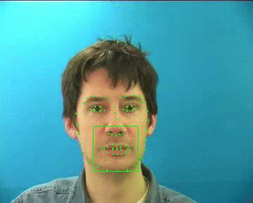

# ssl-kaldi

**Self-Supervised Learning features for [Kaldi](https://github.com/kaldi-asr/kaldi) ASR.**

[](LICENSE)
[](https://www.python.org/)
[](https://github.com/ialmajai/ssl-kaldi/actions/workflows/ci.yml)
[](#contributing)

Kaldi recipes that replace MFCCs with self-supervised (SSL) encoder features such as HuBERT, mHuBERT, MMS and AV-HuBERT. Shared scripts extract the features, reduce them with PCA for the GMM stages, and feed them to Kaldi's GMM-HMM and chain (TDNN-F) training. Pretrained models can be used frozen or adapted to the task before extraction.

## Quick Start

```
git clone https://github.com/ialmajai/ssl-kaldi.git
cd ssl-kaldi
conda create -n ssl-kaldi python=3.11 -y
conda activate ssl-kaldi
pip install -r requirements.txt
cd egs/mini_librispeech/s5
./run.sh --stop-stage 12      # needs a Kaldi build; see Getting Started
```

This downloads Mini LibriSpeech, extracts MMS-300m layer 14 features and trains the GMM ladder. The [recipe README](egs/mini_librispeech/s5/README.md) covers the chain stage.

<p align="center">
  
  <br>
  <em>Lip-region tracking from the <a href="egs/grid/s5/README.md">GRID lipreading recipe</a> (AV-HuBERT visual features).</em>
</p>

## Design

- **Frozen or adapted encoders.** Any pretrained or fine-tuned SSL checkpoint serves as the feature extractor. Frozen models need no training loop; LoRA or full fine-tuning plug in the same way.
- **Straight into Kaldi.** Features are written as standard `ark/scp`, so Kaldi's hybrid and chain (TDNN-F) pipelines work unchanged.
- **One toolkit, audio *and* video.** Shared extraction, PCA, and upsampling blocks drive HuBERT, mHuBERT, AfriHuBERT, and AV-HuBERT alike.
- **Small datasets.** Recipes span English, Arabic, Swahili and visual speech; mini_librispeech trains on 5 hours of audio.

## Pipeline Overview

```
Audio / Video
      ↓
Pretrained SSL model (PyTorch)
      ↓
Frame-level feature extraction
      ↓
PCA dimensionality reduction / Upsampling (optional)
      ↓
Kaldi ark/scp features
      ↓
Standard Kaldi training & decoding
```

The shared building blocks live in [`shared/`](shared/) (SSL extraction, PCA, interpolation, upsampling) and are reused across every recipe in [`egs/`](egs/).

## Recipes

| Recipe | Task | SSL model | Headline result |
|--------|------|-----------|-----------------|
| [mini_librispeech](egs/mini_librispeech/s5/README.md) | English ASR | MMS / HuBERT | **3.88% WER** (dev-clean, chain TDNN, MMS-300m) |
| [iqraeval](egs/iqraeval/s5/README.md) | Arabic phone recognition | mHuBERT | **11.27% PER** (TDNN-F) |
| [grid](egs/grid/s5/README.md) | Visual speech recognition (lipreading) | AV-HuBERT | **5.83% WER** (unseen speakers, TDNN-F chain) |
| [swahili](egs/swahili/s5/README.md) | Swahili ASR | AfriHuBERT / mHuBERT | **19.47% WER** (E2E TDNN-F, mHuBERT-147) |
| [timit](egs/timit/s5/README.md) | English phone recognition | MMS / HuBERT | **10.19% PER** (core test, chain TDNN) |

## Getting Started

### Prerequisites

A working [Kaldi](https://github.com/kaldi-asr/kaldi) installation is required. Outside Docker, point the recipes at it with `export KALDI_ROOT=/path/to/kaldi`. Either follow the official Kaldi setup or use the provided Docker images:

```
# CUDA + Kaldi + SSL feature-extraction dependencies
docker build -t ssl-kaldi docker/
docker run --gpus all -it ssl-kaldi
```

The `docker/` directory also ships `Dockerfile.grid`, which adds the extra dependencies (dlib, AV-HuBERT) needed for the GRID lipreading recipe.

### Create a conda environment

```
git clone https://github.com/ialmajai/ssl-kaldi.git
cd ssl-kaldi
conda create -n ssl-kaldi python=3.11 -y
conda activate ssl-kaldi

pip install -r requirements.txt        # or: pip install -r requirements.lock  (pinned, reproducible)
```

Some recipes have additional requirements; see the per-recipe README. In particular, the [GRID lipreading recipe](egs/grid/s5/README.md) also needs AV-HuBERT, fairseq, and dlib (see its own [`requirements.txt`](egs/grid/s5/requirements.txt)).

## Contributing

Suggestions for improvements or new features are always welcome. Feel free to open an issue or submit a pull request. See [CONTRIBUTING.md](CONTRIBUTING.md) for development setup, code style, and how to add a recipe.

## Citation

```
@misc{ssl_kaldi,
  author       = {Ibrahim Almajai},
  title        = {ssl-kaldi: self-supervised speech features for Kaldi ASR recipes},
  year         = {2025},
  howpublished = {\url{https://github.com/ialmajai/ssl-kaldi}},
  note         = {Accessed: 2026-08}
}
```

## License

Released under the [Apache 2.0](LICENSE) license.

## Contact

Ibrahim Almajai (ialmajai@gmail.com)
