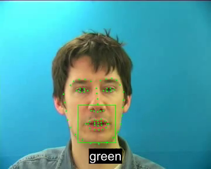

# Lipreading Recipe using AV-HuBERT and the GRID Corpus

Visual speech recognition (lipreading) on the [GRID corpus](https://spandh.dcs.shef.ac.uk/gridcorpus)
using frozen [AV-HuBERT](https://github.com/facebookresearch/av_hubert) visual features in Kaldi
GMM-HMM and chain pipelines.

## Quick Start

Install AV-HuBERT and dlib into the repo environment. We have run AV-HuBERT's fairseq on
Python 3.8 and 3.10 (the Docker image) but not on 3.11, so create the environment with
`python=3.10`.

```
conda activate ssl-kaldi
cd egs/grid/s5
pip install pip==24.0
pip install -r requirements.txt
git clone https://github.com/facebookresearch/av_hubert.git --depth=1
cd av_hubert
git submodule init
git submodule update
cd fairseq
pip install --editable ./
conda install -c conda-forge dlib==19.18.0
cd ../..
```

Then run the recipe. The 5.85% system uses large AV-HuBERT, layer 13:

```
./run.sh --stage -1 --model-size large   # downloads, features, GMM-SAT, fMLLR TDNN-F chain
```

For the Lombard GRID results, fetch the front-view videos and decode them:

```
mkdir -p lombard-grid
wget -O lombard-grid/lombardgrid_front.zip "https://zenodo.org/records/3736465/files/lombardgrid_front.zip?download=1"
unzip -q lombard-grid/lombardgrid_front.zip -d lombard-grid   # -> lombard-grid/lombardgrid/front
./run.sh --stage 14 --model-size large
```

## Unseen-speaker performance

| System            | Setting         | Grammar/LM         | Data augmentation                        | WER (unseen speaker) |
| ----------------- | --------------- | ------------------ | ---------------------------------------- | -------------------- |
| LipNet            | unseen speakers | Fixed GRID grammar | Spatial/temporal jitter, mirroring, etc. | 11.4% |
| SSL-Kaldi GMM-HMM (SAT) | unseen speakers | Fixed GRID grammar | None                                | 6.05% |
| SSL-Kaldi TDNN-F chain (fMLLR) | unseen speakers | Fixed GRID grammar | None                          | **5.85%** |

GRID test WERs in this README are on all 4,000 clips of the unseen speakers (s1, s2, s20, s22).

On [Lombard GRID](https://spandh.dcs.shef.ac.uk/avlombard/) (out-of-domain, unseen in training), all
but one system score better than in-domain. Lombard speakers talk with more effort and clearer
articulation. Speaker adaptation decides how much of that gain a system keeps:

| System | base, layer 4 (in-domain → Lombard) | large, layer 13 (in-domain → Lombard) |
| ------ | ------------------------------------ | --------------------------------------- |
| GMM-SAT               | 7.38% → 5.39% | 6.05% → 4.73% |
| TDNN-F chain on fMLLR features | 6.76% → 5.32% | 5.85% → **4.66%** |
| Flat-start e2e chain, renorm + no-relu | 7.55% → 7.16% | 6.47% → 5.41% |
| Flat-start e2e chain, + full CMVN | 7.15% → 7.35% | 6.45% → 5.76% |

Without CMVN, the flat-start e2e chain gains 0.39 abs on base L4 and 1.06 on large L13. GMM-SAT and
the TDNN-F chain built on it apply a per-speaker fMLLR transform and gain 1.2-2.0 abs.

Full CMVN gives the e2e chain a small in-domain gain and a small Lombard loss at both encoder sizes.
Both effects sit within run-to-run noise: retraining the base-l4 CMVN chain moved its in-domain WER by
about 0.4 abs (RESULTS, 2026-10 rows).

## More Results (WER)

- 30-dimensional PCA for the HMM-GMM systems.
- Features upsampled from 25 to 50 fps.
- Mouth crops aligned to a mean face instead of the earlier centroid crop.
- Layer 4 for base AV-HuBERT and layer 13 for large, picked by a layer sweep over the old
  defaults of 9 and 12. A full mono→SAT ladder confirms both.
- Speaker adaptation (LDA+MLLT+SAT) beats TDNN systems trained on raw features, as this
  [paper](https://ueaeprints.uea.ac.uk/id/eprint/63479/1/Accepted_manuscript.pdf) found for visual
  speech features.

| AV-HuBERT           | Monophone | Triphone (Δ+ΔΔ) | Triphone + LDA+MLLT | Triphone + LDA+MLLT+SAT |
| -------------------- | --------- | --------------- | ------------------- | ----------------------- |
| base, layer 4 (50fps)  | 19.00     | 9.85            | 8.94                 | 7.38 |
| large, layer 13 (50fps) | 19.35     | 8.57            | 7.13                 | **6.05** |

We left out 25 fps rows. We measured them at the old default layers (9 base, 12 large) with the
earlier centroid crop, so they don't compare with the numbers above. Standard Kaldi HMM topologies
lose accuracy on 40 ms frames, and the table uses 50 fps throughout.

### Chain results

We trained two chain architectures on these features:

| Chain architecture | base, layer 4 | large, layer 13 |
| ------------------- | ------------- | ---------------- |
| Flat-start e2e (raw features, renorm + no-relu input layer + full CMVN) | 7.15% | 6.45% |
| TDNN-F on fMLLR features (speaker-adapted, GMM-SAT-derived, `local/chain/run_tdnn_fmllr_tdnnf.sh`) | **6.76%** | **5.85%** |

Adding full CMVN to the renorm+no-relu e2e chain moves base-layer-4 from 7.55% to 7.15% and
large-layer-13 from 6.47% to 6.45%. The base gain is about the size of run-to-run noise.

At both encoder sizes, the TDNN-F chain on fMLLR features beats the flat-start e2e chain and the
GMM-SAT system under it. Large layer 13 gives the recipe's best WER, 5.85%.

### Fine-tuned encoders

`run_ctc_finetune.sh` fine-tunes AV-HuBERT with a letter CTC head, either with
rank-32 LoRA or with every weight trainable, then extracts features from the
fine-tuned encoder for the flat-start e2e chain. Run it after `run.sh` stages
0-2 and 14. On one GPU, a fine-tune took 47 min (base LoRA) to 2 h 10 min (large
LoRA) in our runs, before feature extraction and chain training.

```
./run_ctc_finetune.sh                                    # LoRA, base, layer 10
./run_ctc_finetune.sh --config base_ctc_full             # every weight trainable
./run_ctc_finetune.sh --config large_ctc_lora --layer 20
```

| Encoder | Fine-tuning, layer | Trainable | GRID test | Lombard eval |
| ------- | ------------------ | --------- | --------- | ------------ |
| base  | none, L4           | 0     | 7.15 | 7.30 |
| base  | full, L10          | 103M  | **5.70** | 7.68 |
| base  | LoRA r32, L10      | 5.3M  | 6.34 | **5.70** |
| large | none, L13 (fMLLR chain) | 0 | 5.85 | **4.54** |
| large | full, L20          | 325M  | 6.25 | 8.49 |
| large | LoRA r32, L20      | 14M   | **5.55** | 5.05 |

Lombard eval covers the 40 speakers outside `local/lombard_dev_speakers.txt`;
the dev speakers chose the fine-tuned layers. Full fine-tuning gains in domain
for base and loses on Lombard for both sizes. LoRA keeps the Lombard gain.

### Mouth tracking and word alignment

[](figures/tracking.gif)

## Citation

If you use this recipe, please cite **ssl-kaldi**, [AV-HuBERT](https://github.com/facebookresearch/av_hubert), the [GRID corpus](https://spandh.dcs.shef.ac.uk/gridcorpus) and, for the Lombard results, the [Lombard GRID corpus](https://spandh.dcs.shef.ac.uk/avlombard/).

```
@misc{ssl_kaldi,
  author       = {Ibrahim Almajai},
  title        = {ssl-kaldi: self-supervised speech features for Kaldi ASR recipes},
  year         = {2025},
  howpublished = {\url{https://github.com/ialmajai/ssl-kaldi}},
  note         = {Accessed: 2026-08}
}

@article{shi2022avhubert,
  author  = {Bowen Shi and Wei-Ning Hsu and Kushal Lakhotia and Abdelrahman Mohamed},
  title   = {Learning Audio-Visual Speech Representation by Masked Multimodal Cluster Prediction},
  journal = {arXiv preprint arXiv:2201.02184},
  year    = {2022}
}

@article{alghamdi2018lombard,
  title   = {A corpus of audio-visual {Lombard} speech with frontal and profile views},
  author  = {Alghamdi, Najwa and Maddock, Steve and Marxer, Ricard and Barker, Jon and Brown, Guy J.},
  journal = {The Journal of the Acoustical Society of America},
  volume  = {143},
  number  = {6},
  pages   = {EL523--EL529},
  year    = {2018}
}

@article{cooke2006audio,
  title     = {An audio-visual corpus for speech perception and automatic speech recognition},
  author    = {Cooke, Martin and Barker, Jon and Cunningham, Stuart and Shao, Xu},
  journal   = {The Journal of the Acoustical Society of America},
  volume    = {120},
  number    = {5},
  pages     = {2421--2424},
  year      = {2006},
  publisher = {AIP Publishing}
}
```

## Contact

Ibrahim Almajai (ialmajai@gmail.com)
