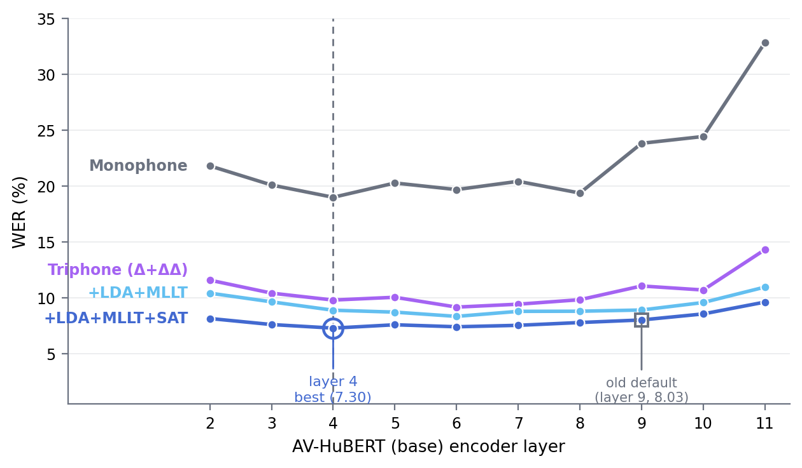
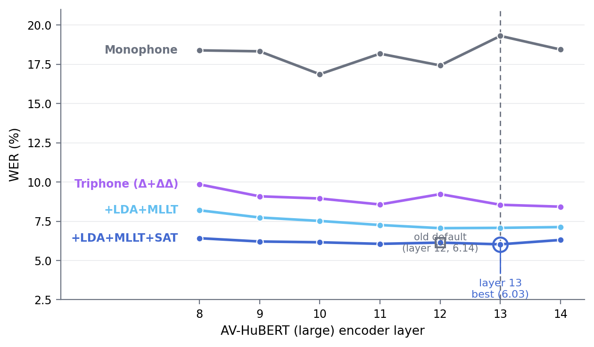

# Lipreading Recipe using AV-HuBERT and the GRID Corpus

Visual speech recognition (lipreading) on the [GRID corpus](https://spandh.dcs.shef.ac.uk/gridcorpus)
using frozen [AV-HuBERT](https://github.com/facebookresearch/av_hubert) visual features in Kaldi
GMM-HMM and chain pipelines.

## Quick Start

Install AV-HuBERT and dlib into the repo environment:

```
conda activate ssl-kaldi
cd egs/grid/s5
pip install pip==24.0
pip install -r requirements.txt
git clone https://github.com/facebookresearch/av_hubert.git --depth=1
cd av_hubert
git submodule init
git submodule update
cd fairseq
pip install --editable ./
conda install -c conda-forge dlib==19.18.0
cd ../..
```

Then run the recipe. The 5.83% system uses large AV-HuBERT, layer 13:

```
./run.sh --stage -1 --model-size large   # corpus + checkpoint download, features, GMM-SAT, fMLLR features
local/chain/run_tdnn_fmllr_tdnnf.sh      # TDNN-F chain on the fMLLR features
```

## Unseen-speaker performance

| System            | Setting         | Grammar/LM         | Data augmentation                        | WER (unseen speaker) |
| ----------------- | --------------- | ------------------ | ---------------------------------------- | -------------------- |
| LipNet            | unseen speakers | Fixed GRID grammar | Spatial/temporal jitter, mirroring, etc. | 11.4% |
| SSL-Kaldi GMM-HMM (SAT) | unseen speakers | Fixed GRID grammar | None                                | 6.03% |
| SSL-Kaldi TDNN-F chain (fMLLR) | unseen speakers | Fixed GRID grammar | None                          | **5.83%** |

On [Lombard GRID](https://spandh.dcs.shef.ac.uk/gridcorpus) (out-of-domain, unseen during training), every
system scores better than its own in-domain result, consistent with the Lombard effect producing more
effortful, clearer speech -- but the size of that gap depends heavily on speaker adaptation:

| System | base, layer 4 (in-domain → Lombard) | large, layer 13 (in-domain → Lombard) |
| ------ | ------------------------------------ | --------------------------------------- |
| GMM-SAT               | 7.30% → 5.39% | 6.03% → 4.73% |
| TDNN-F chain on fMLLR features | 6.72% → 5.32% | 5.83% → **4.66%** |
| Flat-start e2e chain, renorm + no-relu | 7.51% → 7.16% | 6.43% → 5.41% |
| Flat-start e2e chain, + full CMVN | 7.11% → 7.35% | 6.41% → 5.76% |

The flat-start e2e chain barely benefits from Lombard's clearer speech (base-l4: only 0.35% abs without
CMVN). The two systems that use a per-speaker fMLLR transform, GMM-SAT and the TDNN-F chain built on
it, gain 1.2-1.9% abs.

Full CMVN gives the e2e chain a small in-domain gain and a small Lombard loss, at both encoder sizes.
Both effects are within run-to-run noise: retraining the base-l4 CMVN chain moves its in-domain WER by
about 0.4 abs (RESULTS, 2026-10 rows).

## More Results (WER)

- 30-dimensional PCA for the HMM-GMM systems.
- Features upsampled to 50 fps give better results.
- Mean-face-aligned features (see below), not the earlier centroid crop.
- A layer sweep (below) shows layer 4 is best for base AV-HuBERT (not layer 9) and layer 13
  is best for large AV-HuBERT (not layer 12) -- both re-validated with a full mono→SAT ladder.
- Speaker adaptation (MLLT+SAT) outperforms TDNN systems trained on raw features. The power of such
  adaptation for visual speech features has already been demonstrated in this
  [paper](https://ueaeprints.uea.ac.uk/id/eprint/63479/1/Accepted_manuscript.pdf).

| AV-HuBERT           | Monophone | Triphone (Δ+ΔΔ) | Triphone + LDA+MLLT | Triphone + LDA+MLLT+SAT |
| -------------------- | --------- | --------------- | ------------------- | ----------------------- |
| base, layer 4 (50fps)  | 19.00     | 9.81            | 8.90                 | 7.30 |
| large, layer 13 (50fps) | 19.31     | 8.55            | 7.08                 | **6.03** |

25fps rows are omitted here: they were only ever measured at the old default layers
(9 base / 12 large) under the earlier centroid crop and are not comparable to the numbers
above. Standard Kaldi HMM topologies handle 40ms frames poorly, which is why every row
here uses 50fps.

### Chain results

Two chain architectures were tried on top of the layer-sweep features:

| Chain architecture | base, layer 4 | large, layer 13 |
| ------------------- | ------------- | ---------------- |
| Flat-start e2e (raw features, renorm + no-relu input layer + full CMVN) | 7.11% | 6.41% |
| TDNN-F on fMLLR features (speaker-adapted, GMM-SAT-derived, `local/chain/run_tdnn_fmllr_tdnnf.sh`) | **6.72%** | **5.83%** |

Adding full CMVN to the renorm+no-relu e2e chain moves base-layer-4 from 7.51% to 7.11% and
large-layer-13 from 6.43% to 6.41%. The base gain is about the size of run-to-run noise.

The fMLLR-feature TDNN-F chain beats both the flat-start e2e chain and the GMM-SAT system it is
built on, for both encoder sizes -- the large-layer-13 result (5.83%) is the best result in this
recipe.

### Base AV-HuBERT layer sweep

WER against encoder layer for base AV-HuBERT (50fps, mean-face-aligned features), at every
stage of the GMM ladder. Layer 4 is a clear local minimum, beating the previously-used
layer 9 by 0.73 abs (~9% relative) at the LDA+MLLT+SAT stage.



### Large AV-HuBERT layer sweep

Same sweep for large AV-HuBERT (50fps, mean-face-aligned features), layers 8-14. The
minimum is shallow and noisy across 9-13 (spread of only 0.18 abs) with clear degradation
at both edges; layer 13 is best, beating the previously-used layer 12 by 0.11 abs.



### Tracking & Word Alignment Demo

[](demo/tracking-demo.gif)

### Interactive Lipreading Demo

Runs a fine-tuned variant of this recipe end to end on your own clip: base AV-HuBERT with a rank-32
LoRA adapter (`input/avhubert_base_ctc_lora.pt`, layer 10) -> flat-start e2e TDNN-F chain trained on
clean plus one augmented copy (`run_demo_base_lor10_aug2x.sh`). It scores 6.33% WER on the
unseen-speaker test set and 5.42% on the Lombard eval speakers. Word confidences fuse lattice MBR
with a TruCLeS confidence model (`run_demo_base_lor10_conf.sh`).

```
# CLI -- print the recognised text for one video
local/demo/demo.py grid-corpus/s1/bbaf2n.mpg

# Gradio web UI -- upload or record a clip, see the mouth ROI + prediction
local/demo/demo.py --ui
```

Only understands GRID's fixed 6-word grammar (command · colour · preposition · letter · digit ·
adverb, e.g. "place green with h eight now"); clips must be 2-15s (up to 20s from a webcam) with a
single frontal face.

## Citation

If you use this recipe, please cite **ssl-kaldi**, [AV-HuBERT](https://github.com/facebookresearch/av_hubert), and the [GRID corpus](https://spandh.dcs.shef.ac.uk/gridcorpus).

```
@misc{ssl_kaldi,
  author       = {Ibrahim Almajai},
  title        = {ssl-kaldi: self-supervised speech features for Kaldi ASR recipes},
  year         = {2025},
  howpublished = {\url{https://github.com/ialmajai/ssl-kaldi}},
  note         = {Accessed: 2026-08}
}

@article{shi2022avhubert,
  author  = {Bowen Shi and Wei-Ning Hsu and Kushal Lakhotia and Abdelrahman Mohamed},
  title   = {Learning Audio-Visual Speech Representation by Masked Multimodal Cluster Prediction},
  journal = {arXiv preprint arXiv:2201.02184},
  year    = {2022}
}

@article{cooke2006audio,
  title     = {An audio-visual corpus for speech perception and automatic speech recognition},
  author    = {Cooke, Martin and Barker, Jon and Cunningham, Stuart and Shao, Xu},
  journal   = {The Journal of the Acoustical Society of America},
  volume    = {120},
  number    = {5},
  pages     = {2421--2424},
  year      = {2006},
  publisher = {AIP Publishing}
}
```

## Contact

Ibrahim Almajai (ialmajai@gmail.com)
