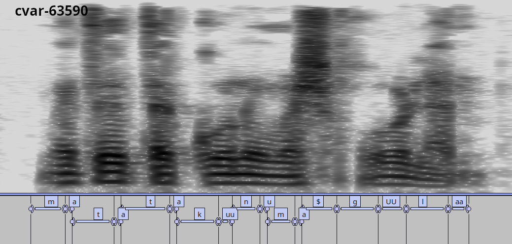

# IqraEval

Arabic phone recognition on the [IqraEval Challenge](https://huggingface.co/IqraEval)
data. The recipe runs a Kaldi GMM ladder and then an LF-MMI chain model on frozen
[mHuBERT-147](https://huggingface.co/utter-project/mHuBERT-147) embeddings instead
of MFCCs.

## Quick Start

After downloading the data and building KenLM (see [Requirements](#requirements)):

```
conda activate ssl-kaldi
cd egs/iqraeval/s5
./run.sh --stop-stage 6 --IqraEvalData /path/to/sws_data
sudo nvidia-smi -c 3      # chain training runs 2-5 GPU jobs
./run.sh --stage 7        # chain TDNN-F
./run_e2e.sh              # optional: flat-start e2e chain, no GMM stages
```

## Feature layout

| Data directory | Features | Used by |
|----------------|----------|---------|
| `data/<set>_raw` | mHuBERT encoder output, 768-d, 20 ms frame shift | chain TDNN-F |
| `data/<set>_pca` | PCA-reduced SSL features (30-d by default) | mono / tri1 / tri2 |

`shared/make_ssl.sh` runs the SSL model as a frozen feature extractor and writes
ordinary Kaldi `ark/scp` archives.

This is the largest recipe in the repo: 71,376 training utterances and 2.34 M
words of text, against 3,696 utterances for timit.

## Requirements

- The IqraEval CV-Ar and TTS data (see below).
- A Kaldi build. No IRSTLM or sph2pipe needed here.
- [KenLM](https://github.com/kpu/kenlm), which builds the phone bigram and
  trigram LMs used for decoding.
- The repo's Python environment (see the [top-level README](../../../README.md)).
- Disk space for the simulated RIR package, which stage 6 downloads.

### Downloading the data

Follow [Iqra-Eval](https://github.com/Iqra-Eval/interspeech_IqraEval):

```
python download_hugg_data.py --path "IqraEval/Iqra_train" --split "train" --output_dir "./sws_data/CV-Ar"

python download_hugg_data.py --path "IqraEval/Iqra_train" --split "dev" --output_dir "./sws_data/CV-Ar"

python download_hugg_data_tts.py --path "IqraEval/Iqra_TTS" --split "train" --output_dir "./data/TTS" --dev_name "Amer"
```

Then pass the resulting `sws_data` directory as `--IqraEvalData`, or link it
to `sws_data` in the recipe directory, the default.

### Building KenLM

Clone it into the recipe directory and the scripts find it:

```
cd egs/iqraeval/s5
git clone https://github.com/kpu/kenlm.git
cd kenlm
mkdir build && cd build
cmake ..
make -j$(nproc)
```

`local/iqra_prepare_lms.sh` looks for `bin/lmplz` under `./kenlm/build`, then
`$KALDI_ROOT/tools/kenlm/build`, then for `lmplz` on `PATH` (a conda `kenlm`
package works). For a build somewhere else, point `KENLM` at its build directory:

```
KENLM=/path/to/kenlm/build ./run.sh
```

## Stages

| Stage | What it does |
|-------|--------------|
| 0 | Data prep, lexicon, `data/lang`, KenLM phone bigram and trigram LMs |
| 1 | SSL feature extraction + CMVN (`data/*_raw`) |
| 2 | PCA model + PCA features (`data/*_pca`) |
| 3 | mono, on a 5 k-utterance subset |
| 4 | tri1 (Δ+ΔΔ) |
| 5 | tri2 (LDA+MLLT) |
| 6 | Speed perturbation, tri2 alignments and reverberation (`local/chain/run_common.sh`) |
| 7 | Chain TDNN-F (`local/chain/run_tdnn_mhubert_mono_rvb.sh`) |

The ladder stops at tri2, with no SAT/fMLLR stage: fMLLR gave no gain on the audio
SSL features in this repo. The chain model takes its alignments from tri2.

Pick the model and layer with `ssl_model` / `encoder_layer` at the top of
`run.sh`, or as options. Feature extraction needs the GPU in default compute
mode (`sudo nvidia-smi -c 0`), and stage 1 exits if it isn't.

`run-mfcc.sh` reproduces the MFCC baseline in the comparison table below.

## Results (PER, dev)

Setup notes:

- 30-dimensional PCA for the HMM-GMM systems, full 768-d features for the chain.
- The SSL encoder emits 50 fps (MFCCs run at 100 fps), so the chain model uses
  `--frame-subsampling-factor 2` instead of the usual 3.
- Decoding uses a KenLM trigram phone LM.
- The chain model uses a monophone tree
  (`--context-width=1 --central-position=0`), no i-vectors, and one reverberated
  copy of the training data.

The recipe taps layer 9, the best layer for the GMM systems.

Comparison with MFCCs, and with the challenge baseline:

| Model Type      | mono  | Δ+ΔΔ  | LDA+MLLT | tdnnf     | e2e_tdnnf |
| --------------- | ----- | ----- | -------- | --------- | --------- |
| MFCC            | 53.85 | 43.47 | 41.65    | -         | -         |
| SSL (9th layer) | **26.98** | **20.53** | **18.77** | **11.27** | 11.88     |
| IqraEval baseline | -   | -     | -        | 16.42     | -         |

Frozen mHuBERT features cut the MFCC phone error rate by more than half at each
GMM stage. The chain model reaches 11.27 against the challenge baseline's 16.42.



## Scoring

`local/score.sh` sweeps LM weights 1 to 35 instead of Kaldi's default 1 to 10,
since the best phone-LM weights here run high. `local/bwer.sh` prints the best
WER for every decode directory:

```
local/bwer.sh          # everything
local/bwer.sh chain    # only the chain systems
```

Current numbers are in [RESULTS](RESULTS).

## Citation

```
@misc{ssl_kaldi,
  author       = {Ibrahim Almajai},
  title        = {ssl-kaldi: self-supervised speech features for Kaldi ASR recipes},
  year         = {2025},
  howpublished = {\url{https://github.com/ialmajai/ssl-kaldi}},
  note         = {Accessed: 2026-08}
}

@inproceedings{elkheir2025iqraeval,
  title     = {Iqra'Eval: A Shared Task on Qur'anic Pronunciation Assessment},
  author    = {El Kheir, Yassine and Meghanani, Amit and Toyin, Hawau Olamide and Almarwani, Nada and Ibrahim, Omnia and Elshahawy, Youssef and Shahin, Mostafa and Ali, Ahmed},
  booktitle = {Proceedings of the Third Arabic Natural Language Processing Conference},
  year      = {2025},
  publisher = {Association for Computational Linguistics}
}
```
