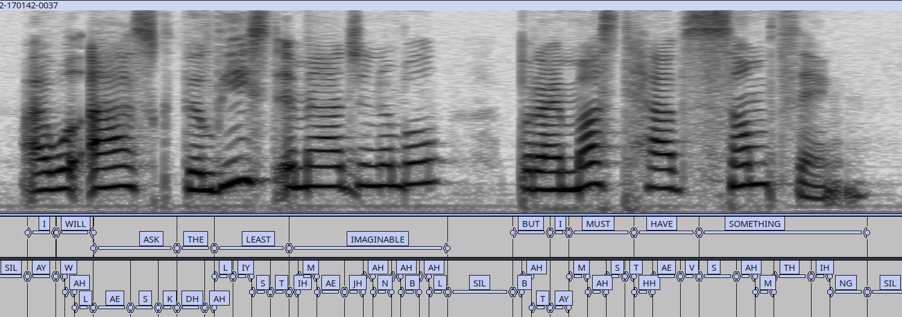

# Mini LibriSpeech

Kaldi speech recognition on Mini LibriSpeech with frozen self-supervised encoders (MMS, WavLM, HuBERT, XLS-R) as acoustic features. The recipe trains a GMM-HMM ladder and a chain TDNN on top of them.

## Quick Start

```
conda activate ssl-kaldi
cd egs/mini_librispeech/s5
./run.sh --stop-stage 12           # corpus + LM download, MMS-300m L14 features, GMM ladder
./run.sh --stage 13                # chain TDNN (one training job), decoded with tglarge
```

Feature extraction needs the GPU in Default mode (`sudo nvidia-smi -c 0`).
Pick another encoder with `--ssl-model` and `--encoder-layer`.

## Results (WER % on dev-clean, tglarge LM)

| Features | Acoustic Model | WER (%) |
|-----------|---------------|---------|
| **MMS-300m (layer 14)** | **Chain TDNN** | **3.88** |
| WavLM Base+ (layer 9) | Chain TDNN | 3.97 |
| HuBERT Large (LL60K, layer 14) | Chain TDNN | 4.15 |
| HuBERT Base (LS960, layer 9) | Chain TDNN | 4.28 |
| MMS-300m (layer 14) | E2E TDNN-F | 4.48 |
| HuBERT Large (LL60K, layer 12) | Chain TDNN | 4.70 |
| XLS-R-300m (layer 12) | Chain TDNN | 4.86 |
| MMS-300m (layer 14) | Tri3b | 10.87 |
| Kaldi MFCC/filterbank baseline | CNN-TDNN | 6.79 |

## Key Findings

- `facebook/mms-300m` layer 14 with a chain TDNN gives the best result, **3.88% WER**, a **43% relative reduction** on the Kaldi MFCC/filterbank baseline (6.79% → 3.88%).
- Encoder size does not decide the ranking: WavLM Base+ (95 M parameters) matches MMS-300m (315 M) to within 0.09, and XLS-R-300m trails both despite sharing MMS-300m's architecture. English is a thin slice of XLS-R's 128-language pretraining mixture, and the same encoder ties mHuBERT-147 on the Swahili recipe.
- Layer choice matters: for HuBERT Large, layer 14 gives 4.15 and layer 12 gives 4.70.
- MMS-300m features also help the Tri3b GMM-HMM system, which drops from 13.18 with MFCCs to 10.87.
- The MMS-300m, WavLM and XLS-R chain rows share one tree, alignments and lattices, so they differ only in features.
- See [RESULTS](RESULTS) for the raw decode lines.

## Tested SSL Models

- `facebook/mms-300m`
- `microsoft/wavlm-base-plus`
- `facebook/hubert-base-ls960`
- `facebook/hubert-large-ll60k`
- `facebook/wav2vec2-xls-r-300m`

## Alignment Accuracy



[Play audio](https://rawcdn.githack.com/ialmajai/ssl-kaldi/02d212f330085da3ac7bce5d014dd1027dc6ae5a/egs/mini_librispeech/s5/docs/index.html)
